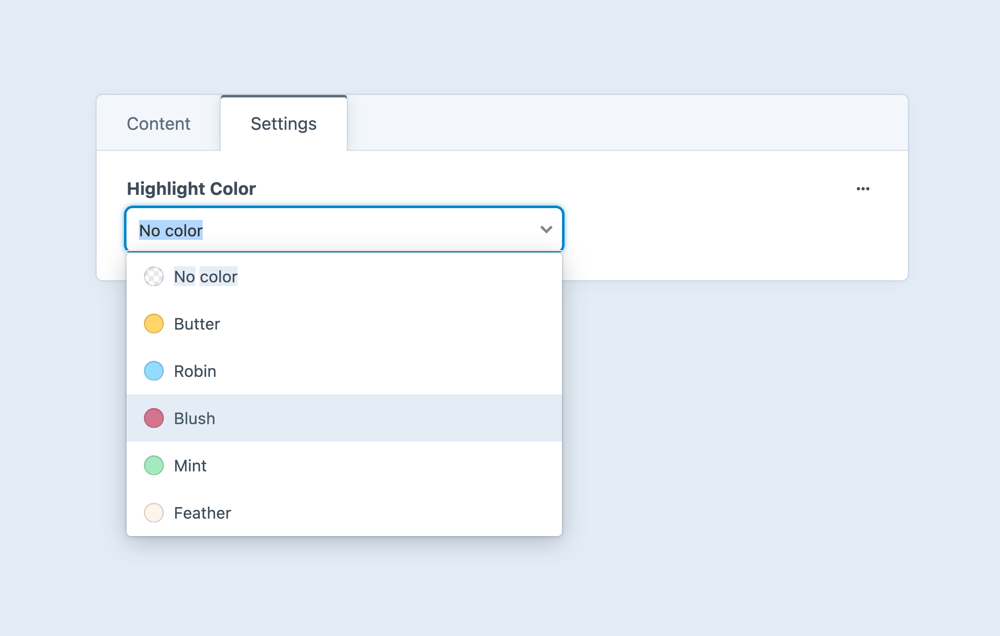
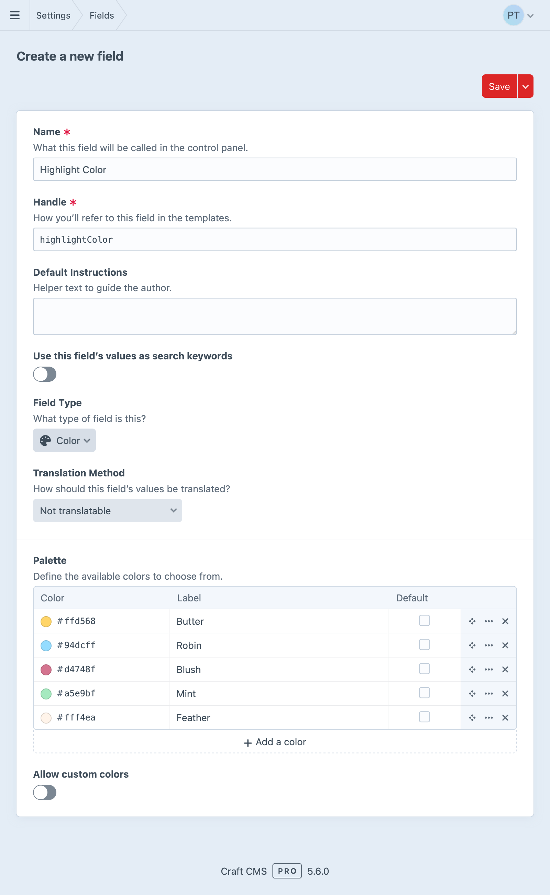

# Color Fields

Color fields provide a flexible way to store hexadecimal color values.
You can define a [palette](#palette) to guide authors <Since ver="5.6.0" feature="Color field palettes" />, or use an [open-ended input](#custom-colors).

<!-- more -->



Color field values (custom, or from a palette) can be translucent. <Since ver="5.12.0" feature="Translucent colors in color fields" />
Enter an 8-digit hex value (like `#0000ff80`) where the last two digits are the alpha channel, or set the opacity in the color picker, in browsers that support it.

## Settings

<BrowserShot
  url="https://my-craft-project.ddev.site/admin/settings/fields/new"
  :link="false"
  :max-height="500"
  caption="Adding a new color field via the control panel.">

</BrowserShot>

### Palette

Each field contains a **Palette** of colors that authors can select from a dropdown menu.

### Custom Colors

Turn on **Allow custom colors** to display a compact input and color preview UI. When used in conjunction with a palette, an additional **Custom…** option is listed at the bottom of the dropdown menu.

::: tip
In [browsers that support `<input type="color">`](https://caniuse.com/input-color), clicking on the color preview “well” opens a native OS color picker.
:::

Turn on **Allow opacity for custom colors** <Since ver="5.12.0" feature="Translucent custom colors" /> to let authors pick translucent custom colors, either with the color picker (in browsers that support it) or by entering an 8-digit hex value. Otherwise, custom colors must be fully opaque. This setting only appears when **Allow custom colors** is on.

### GraphQL Mode <Since ver="5.12.0" feature="Color field GraphQL modes" />

When GraphQL is enabled, the **GraphQL Mode** setting determines how the field’s values are exposed in the [GraphQL API](#graphql).

New color fields default to **Full data**; fields created before Craft 5.12 retain the **Hex only** mode, so existing queries continue to work.

## Development

Accessing a color field returns a <craft5:craft\fields\data\ColorData> object, or `null` if no color was selected.

Casting a `ColorData` object to a string by outputting it directly produces a hexadecimal representation of the color:

::: code
```twig

  <style type="text/css">
    .content a {
      {# Directly outputting the value... #}
      color: {{ entry.myColorField }};
    }
    .content b {
      {# ...is equivalent to: #}
      color: {{ entry.myColorField.getHex() }};
    }
  </style>

```
```php
if ($entry->myColorField) {
    echo $entry->myColorField;
    // …is equivalent to…
    echo $entry->myColorField->getHex();
}
```
:::

`ColorData` objects have a number of methods that streamline working with color values:

::: code
```twig

  {{ entry.myColorField }}                 {# output: #e5422b #}
  {{ entry.myColorField.getHex() }}        {# output: #e5422b #}
  {{ entry.myColorField.getRgb() }}        {# output: rgb(229,66,43) #}
  {{ entry.myColorField.getHsl() }}        {# output: hsl(7,81%,90%) #}
  {{ entry.myColorField.getLuma() }}       {# output: 0.38820862745098 #}
  {{ entry.myColorField.getHue() }}        {# output: 7 #}
  {{ entry.myColorField.getLightness() }}  {# output: 90 #}
  {{ entry.myColorField.getSaturation() }} {# output: 81 #}
  {{ entry.myColorField.getRed() }}        {# output: 229 #}
  {{ entry.myColorField.getGreen() }}      {# output: 66 #}
  {{ entry.myColorField.getBlue() }}       {# output: 43 #}

```
```php
if ($entry->myColorField) {
    echo $entry->myColorField;                  // output: #e5422b
    echo $entry->myColorField->getHex();        // output: #e5422b
    echo $entry->myColorField->getRgb();        // output: rgb(229,66,43)
    echo $entry->myColorField->getHsl();        // output: hsl(7,81%,90%)
    echo $entry->myColorField->getLuma();       // output: 0.38820862745098
    echo $entry->myColorField->getHue();        // output: 7
    echo $entry->myColorField->getLightness();  // output: 90
    echo $entry->myColorField->getSaturation(); // output: 81
    echo $entry->myColorField->getRed();        // output: 229
    echo $entry->myColorField->getGreen();      // output: 66
    echo $entry->myColorField->getBlue();       // output: 43
}
```
:::

You may also access any of the color components as properties: <Since ver="5.8.0" feature="Accessing color data components as properties" />

```twig
{{ entry.myColorField.hex }}
{{ entry.myColorField.rgb }}
{# ... #}
```

### Translucency and Other Formats <Since ver="5.12.0" feature="Translucent colors and additional color formats" />

When a color isn’t fully opaque, Craft stores and returns the alpha channel as two extra hexadecimal digits (like `#e5422b80`).
Pass `false` to `getHex()` to discard the alpha channel (if present) and return a standard six-character hexadecimal code.

Other `ColorData` methods are named explicitly, rather than parameterized (like `getHsl()` and `getHsla()`):

::: code
```twig
{# Given a value of #e5422b80: #}

{{ color.hex }}                    {# output: #e5422b80 #}
{{ color.getHex(false) }}          {# output: #e5422b #}
{{ color.alpha }}                  {# output: 0.5 #}
{{ color.rgba }}                   {# output: rgba(229,66,43,0.5) #}
{{ color.hsla }}                   {# output: hsla(7,78%,53%,0.5) #}
{{ color.rgbChannels }}            {# output: 229 66 43 #}
{{ color.oklch }}
{# output: oklch(61.54% 0.2033 31.22 / 0.5) #}
{{ color.contrastColor }}          {# output: #000000 #}
{{ color.contrastRatio('#ffffff') }} {# output: 4.0810201549497 #}
```
```php
// Given a value of #e5422b80:
$color = $entry->myColorField;
echo $color->hex;                       // output: #e5422b80
echo $color->getHex(false);             // output: #e5422b
echo $color->alpha;                     // output: 0.5
echo $color->rgba;                      // output: rgba(229,66,43,0.5)
echo $color->hsla;                      // output: hsla(7,78%,53%,0.5)
echo $color->rgbChannels;               // output: 229 66 43
echo $color->oklch;
// output: oklch(61.54% 0.2033 31.22 / 0.5)
echo $color->contrastColor;             // output: #000000
echo $color->getContrastRatio('#ffffff'); // output: 4.0810201549497
```
:::

- `alpha` is a number between `0` (fully transparent) and `1` (fully opaque), rounded to two or three places.
- `rgbChannels` contains just the space-separated red, green, and blue channels, which is handy for defining a CSS custom property that you combine with your own opacity: `rgb(var(--brand) / 50%)`.
- `oklch` only includes the alpha channel (`/ 0.5`) when the color isn’t fully opaque.
- `contrastColor` is either black (`#000000`) or white (`#ffffff`), whichever contrasts more with the color—useful for choosing a legible text color to display over it.
- `contrastRatio()` returns the [WCAG 2 contrast ratio](https://www.w3.org/TR/WCAG22/#dfn-contrast-ratio) (between `1` and `21`) between the color and another color, passed as a hex value or `ColorData` object. The result isn’t rounded, so you can compare it directly against WCAG thresholds like `4.5`. Alpha channels are ignored when calculating contrast.

```twig


  <div style="background-color: {{ color }}; color: {{ color.contrastColor }};">
    {{ entry.title }}
  </div>

  
    {# This color isn’t suitable for white text! #}
  

```

### GraphQL

When the field’s [GraphQL Mode](#graphql-mode) is **Hex only**, it returns a hexadecimal string of six or eight characters (when the value includes a relevant [alpha](#translucency-and-other-formats) component).

In **Full data** mode, you can select any of these fields: `hex`, `label`, `red`, `green`, `blue`, `alpha`, `hue`, `saturation`, `lightness`, `luma`, `rgb`, `rgba`, `rgbChannels`, `hsl`, `hsla`, `oklch`, `contrastColor`, and `contrastRatio`.

```gql
query Swatches {
  entries(section: "swatches") {
    title
    ... on swatch_Entry {
      myColorField {
        hex
        opaqueHex: hex(withAlpha: false)
        label
        rgba
        contrastColor
        contrastRatio(with: "#ffffff")
      }
    }
  }
}
```

The `hex` field accepts a `withAlpha` argument (default `true`), and `contrastRatio` requires a `with` argument containing the hex value of the color to compare against.

::: tip
Refer to the [`ColorData`](craft5:craft\fields\data\ColorData) class reference for a complete list of methods!
:::

## Querying by Color

There are no special query features for color fields; refer to the [plain text](plain-text.md) field for a list of standard string comparison syntaxes.
